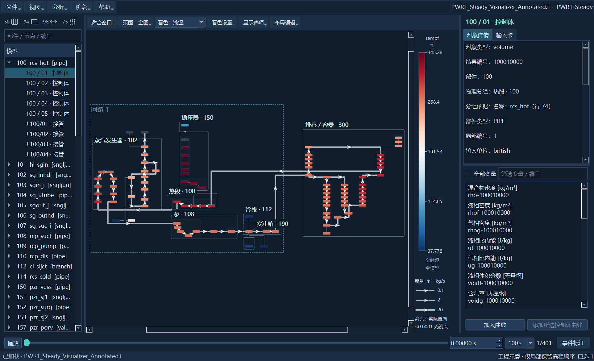

# R5Visualizer

[简体中文](#简体中文) · [English](#english)

## 简体中文

R5Visualizer 是一款面向 **RELAP5/MOD3.3** 的 Windows 后处理工具。打开已有的输入卡和计算结果，即可查看模型拓扑、播放瞬态结果、绘制变量时程曲线，并在同一个项目中查看 NEW 和 RESTART 阶段。

**v0.7.1 公测版 · Windows x64 · 免费使用 · 免激活**

[下载 Windows 公测版](../../releases/tag/v0.7.1) · [报告问题或提出建议](../../issues)

### 快速上手

1. 在 [v0.7.1 Release](../../releases/tag/v0.7.1) 的 **Assets** 里下载 `R5Visualizer-0.7.1-win64-no-examples-portable.zip`。
2. 完整解压 ZIP，打开解压后的 `R5Visualizer` 文件夹，双击 `R5Visualizer.exe`。便携版可直接运行。
3. 在软件中选择 **文件 → 打开输入卡…**，打开自己的 `.i` 文件。同一目录中同名的 `.o` 和 `.r` 文件会自动关联。

完整使用说明随程序提供，可从软件的 **帮助 → 使用说明** 打开。便携包的 SHA-256 校验值见 Release 附件 `SHA256SUMS.txt`。

### 体验算例

两个算例 ZIP 也在 [v0.7.1 Release](../../releases/tag/v0.7.1) 的 **Assets** 中。下载后完整解压，再按下表打开。

| 算例 | 附件 | 如何打开 |
| --- | --- | --- |
| 单环路 PWR 稳态 | `R5Visualizer-Example-PWR1-Steady.zip` | 通过 **文件 → 打开输入卡…** 打开 `PWR1_Steady.i`，浏览拓扑并查看变量曲线。 |
| 主泵断电 | `R5Visualizer-Example-PWR1-Pump-Trip.zip` | 通过 **文件 → 打开项目 / 阶段关联…** 打开 `PWR1-Pump-Trip.r5project.json`。项目包含稳态父阶段与约 60 秒的主泵断电及停堆瞬态，可在时间轴旁切换阶段。 |

### 反馈

欢迎在 [Issues](../../issues) 分享使用体验、报告问题或建议功能。报告问题时，请附上软件版本、Windows 版本、复现步骤以及实际和预期结果。截图、日志和算例请使用可公开的版本。

开发者 **Ru_zhen**。欢迎分享本仓库的下载链接。随程序分发的第三方组件许可见便携包内的 `ThirdPartyNotices`。

## English

R5Visualizer is a Windows postprocessor for **RELAP5/MOD3.3**. Open existing input decks and calculation results to explore model topology, replay transients, plot time histories, and inspect NEW and RESTART stages in a single project.

**v0.7.1 public beta · Windows x64 · Free to use · No activation required**

[Download the Windows public beta](../../releases/tag/v0.7.1) · [Report a bug or suggest a feature](../../issues)

### Quick start

1. Download `R5Visualizer-0.7.1-win64-no-examples-portable.zip` from **Assets** on the [v0.7.1 release page](../../releases/tag/v0.7.1).
2. Extract the entire ZIP, open the extracted `R5Visualizer` folder, and double-click `R5Visualizer.exe`.
3. Choose **File → Open Input Deck…** (**文件 → 打开输入卡…**) and open your `.i` file. The application automatically loads matching `.o` and `.r` files with the same base name in the same folder.

The bundled user guide is available from **Help → User Guide** (**帮助 → 使用说明**). The release asset `SHA256SUMS.txt` contains the SHA-256 checksums.

### Example cases

Download the example ZIPs from **Assets** on the [v0.7.1 release page](../../releases/tag/v0.7.1). Extract each ZIP in full before opening a case.

| Example | Release asset | How to open |
| --- | --- | --- |
| Single-loop PWR steady state | `R5Visualizer-Example-PWR1-Steady.zip` | Choose **File → Open Input Deck…** (**文件 → 打开输入卡…**) and open `PWR1_Steady.i` to explore the topology and plot time histories. |
| Main coolant pump trip | `R5Visualizer-Example-PWR1-Pump-Trip.zip` | Choose **File → Open Project / Stage Link…** (**文件 → 打开项目 / 阶段关联…**) and open `PWR1-Pump-Trip.r5project.json`. The project includes the parent steady-state run and an approximately 60-second transient with a pump trip and reactor scram. Use the selector next to the timeline to switch stages. |

### Feedback

Share your experience, report bugs, or suggest features in [Issues](../../issues). For bug reports, include the R5Visualizer version, your Windows version, steps to reproduce, and the expected and actual behavior. Share screenshots, logs, and case files only if they can be made public.

Developed by **Ru_zhen**. Feel free to share the download link from this repository. Licenses for bundled third-party components are in `ThirdPartyNotices` inside the portable ZIP.
